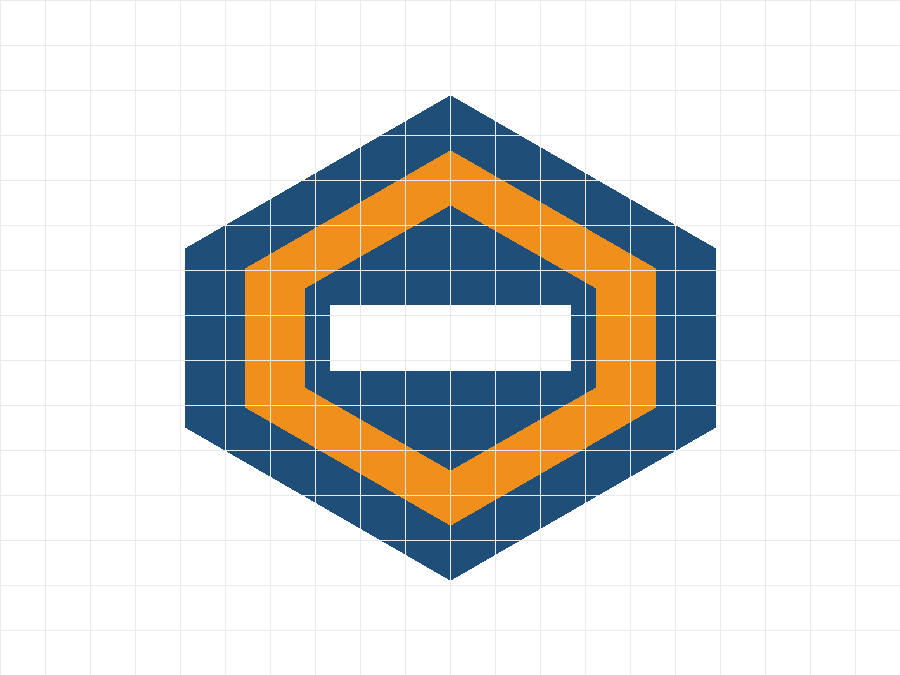
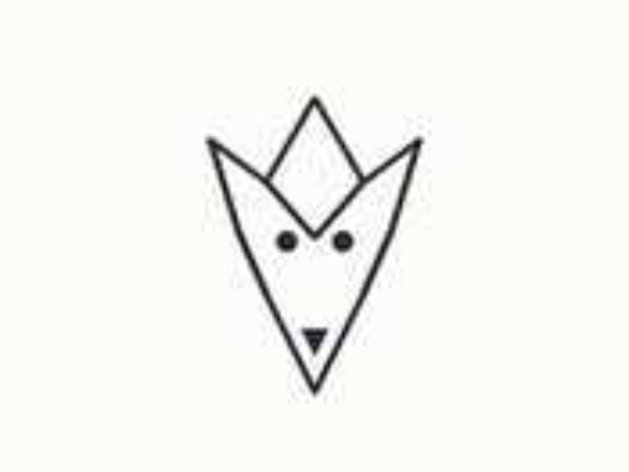
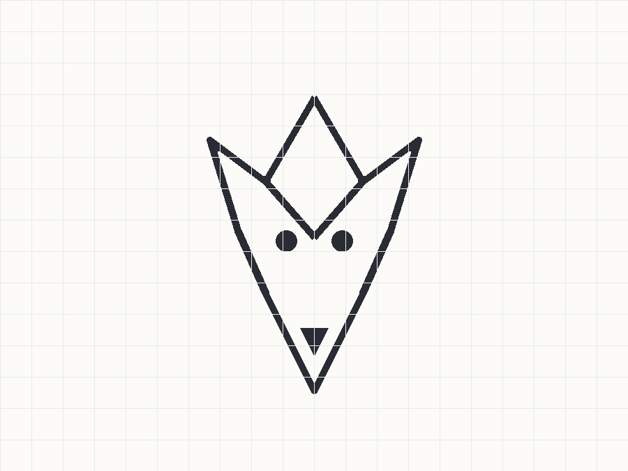

# CleanPaths

**Turn PNG, JPG and SVG images into cut-ready DXF/SVG files — right in your browser. No upload, no account, no watermark.**

🔗 **Live tool: [cleanpaths.io](https://cleanpaths.io)**

Built for Cricut crafters, laser cutters and embroidery creators who need clean vector *cut files*, not just another SVG.

---

## Why CleanPaths

Free online tracers stop at SVG. CleanPaths goes the last mile:

- **Real DXF export, two versions** — R2000 (with units) and R12 compatibility mode
- **Closed paths & color-separated layers** — ready for cutting software
- **Preprocessing pipeline** — cleans up bad images (blur, noise, low contrast) *before* tracing
- **Quality honesty** — flat-color graphics (logos, icons, screenshots, line art) are designed to come out cut-ready; photos come out stylized (posterized), and the tool tells you which one you have *before* you convert

## Privacy by architecture

Everything runs locally in your browser (WebAssembly). **Your files are never uploaded to a server.**

## Before / After

| Input | Output |
|---|---|
|  |  |
|  |  |

More samples: [cleanpaths.io/samples](https://cleanpaths.io/samples)

## Tools

- [PNG to DXF](https://cleanpaths.io/png-to-dxf)
- [JPG to DXF](https://cleanpaths.io/jpg-to-dxf)
- [SVG to DXF Converter](https://cleanpaths.io/svg-to-dxf-converter)
- [Screenshot to SVG](https://cleanpaths.io/screenshot-to-svg)
- [JFIF to JPG](https://cleanpaths.io/jfif-to-jpg)

## Pricing

Free for 10 conversions a day — no account, no watermark. **Pro is $59 one-time** (no subscription): commercial use license, batch processing, AI upscaling. Details: [cleanpaths.io/pricing](https://cleanpaths.io/pricing)

## Tech stack

Next.js static export · WebAssembly image pipeline (runs 100% client-side) · Cloudflare Pages + Workers

## License

Source available for reference. **All rights reserved** — no license is granted to use, copy, modify or distribute this code. The product and brand are proprietary.

---

Feedback: support@cleanpaths.io
